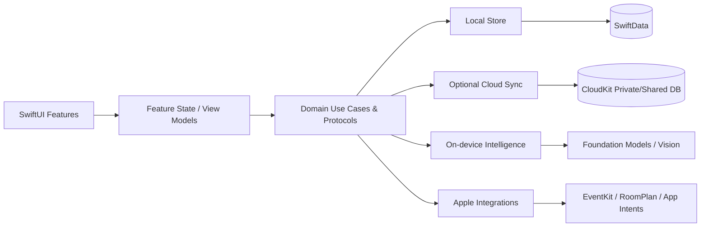

# LunaHearth

Customer guidance: [Product guide](docs/support/product-guide.html), [help and FAQ](docs/support/help-and-faq.html). Publisher-only release preparation: [legal and privacy review](docs/support/legal-review.html). The policy remains a draft until publisher contact and publication details are confirmed.

> Current foundation (ADR-012): local household reminders, shopping, schedules and home records support optional private CloudKit sync and CKShare invitations. Foreground changes sync automatically; live two-account device acceptance is still a release check. Apple Reminders is a separate optional connection. Setup no longer asks for a room. Earlier Apple-only/manual-backup-only implementation notes below are historical. See [ADR-012](docs/ADR/012-live-private-household-sharing.md).


**LunaHearth** is a private, local-first family and home operating system by **NeuralLuna**.

The product combines the parts of everyday household life that are normally scattered across Calendar, Reminders, notes, shopping apps, warranty folders, home inventory tools, and paper receipts:

- Family calendar and shared household events
- Tasks, chores, recurring routines, and maintenance
- Grocery and household shopping lists
- Meal planning
- Home hierarchy: household → floors → rooms → assets/items
- Appliance, furniture, electronics, vehicle, and home-system inventory
- Warranties, purchase details, serial/model numbers, service history
- Receipts, manuals, insurance/registration documents
- Optional RoomPlan room scanning on supported LiDAR devices
- Vision/OCR for receipts, appliance labels, flyers, and documents
- On-device intelligence through Apple Foundation Models when available
- Optional private family synchronization through iCloud/CloudKit
- Widgets and App Intents in later phases

## Product principles

1. **Local first.** The app must be fully useful with airplane mode on.
2. **No LunaHearth account.** No email/password login and no proprietary identity system.
3. **Cloud is optional.** iCloud family sync is opt-in. Local-only mode is first-class.
4. **No third-party data plane.** No Firebase, AWS, Supabase, OpenAI API, analytics SDK, ad SDK, or tracking SDK in the MVP.
5. **Apple frameworks first.** SwiftUI, SwiftData, CloudKit, EventKit, Vision, RoomPlan, Foundation Models, App Intents, WidgetKit, StoreKit.
6. **Privacy is architecture, not copywriting.** Product behavior must support every privacy claim.
7. **Useful on every supported iPhone; enhanced on large/foldable layouts.** Never make core functionality dependent on a Duo-class device.
8. **Home information should drive daily life.** A maintenance plan can create a task; a replacement part can become a shopping item; warranty dates can surface on Today.

## Working product name

`LunaHearth` is a working name. It was chosen after a quick collision search. It is **not** a substitute for formal trademark clearance before launch.

Bundle ID: `com.neuralluna.lunahearth`

Publisher/brand: `NeuralLuna`

## Repository layout

```text
LunaHearth/
├── LunaHearth/
│   ├── App/
│   ├── Core/
│   ├── Domain/
│   ├── Data/
│   ├── Services/
│   ├── Features/
│   └── Resources/
├── LunaHearthTests/
├── docs/
│   └── ADR/
├── .codex/prompts/
├── scripts/
├── AGENTS.md
├── CODEX_TASKS.md
├── project.yml
└── Makefile
```

## Generate the Xcode project

The repository uses **XcodeGen only as a development-time project generator**. It is not an app dependency.

On macOS:

```bash
brew install xcodegen
./scripts/bootstrap.sh
open LunaHearth.xcodeproj
```

Then in Xcode:

1. Select the `LunaHearth` target.
2. Set your Apple Developer Team.
3. Confirm bundle ID `com.neuralluna.lunahearth` or replace it with your registered identifier.
4. Local mode needs no iCloud configuration. Optional manual private backup/restore is available after configuring an Apple team and CloudKit container; see [CloudKit setup](docs/CLOUDKIT_SETUP.md). Live family sharing is not implemented.
5. Run on an iOS simulator/device.

The repository intentionally contains no secrets and no `.env` requirements.

## Minimum OS strategy

The project currently targets **iOS 18+** to keep a broad addressable market. Features introduced later are availability-gated:

- Foundation Models: availability checked at runtime/compile time.
- RoomPlan: only shown on supported devices.
- Duo/foldable-specific behavior: additive and gated by the relevant SDK availability.

Do not raise the minimum OS simply to simplify one optional feature without an ADR.

## Architecture summary



The **local store is authoritative for UX**. CloudKit is synchronization, not the runtime source required for rendering a screen.

## Current implementation

The current UI uses an Uber-inspired black-and-white interface with vivid colorful illustrations and category icons, bold system typography, dark mode, and Dynamic Type. [View actual simulator screenshots](docs/visual-review/index.html).

The app now has a working local foundation:

- Household setup persists locally; people are optional and can be added later.
- Five tabs display real records and helpful empty states, with no seeded household data.
- Quick Add creates events, tasks, groceries, meals, floors, rooms, home items, warranties, and maintenance.
- Planning records support editing and confirmed deletion; tasks and groceries support check-off.
- Home records support editing; items can move between rooms while preserving their links.
- Maintenance completion records history and computes the next calendar-day due date. Replacement shopping items require an explicit action.
- Today shows household events, due/overdue tasks, upcoming home care, meals, and shopping counts.
- Meals store a stable Gregorian date key, independent of the device's time zone after creation.
- SwiftData is explicitly configured with CloudKit mirroring disabled.
- DEBUG builds offer a confirmed local household reset.

Run the app by opening `LunaHearth.xcodeproj`, choosing an iPhone simulator, and pressing Run. Generate the project and run validation with:

```bash
./scripts/verify.sh
```

The script discovers an available iPhone simulator. Override `DEVELOPER_DIR`, `SIMULATOR_ID`, or `DERIVED_DATA_PATH` if needed. `make build` and `make test` use the same discovery.

This is an initial local build, not the complete release roadmap. Remaining work includes document import/preview and OCR, CloudKit sharing, task recurrence/routines, room ordering, purchase-price entry, archive/recovery workflows, accessibility/device QA, widgets, and App Intents. Private iCloud backup/restore, selected Calendar/Reminders connections, and Notes sharing have explicit controls. Additional Apple services remain future work. The user confirmed live iCloud backup; Calendar/Reminders permissions and account behavior require device verification.

See [implementation review and build notes](docs/IMPLEMENTATION_REVIEW.md) and [CODEX_TASKS.md](CODEX_TASKS.md).

## Key Apple references

- CloudKit sharing: https://developer.apple.com/documentation/cloudkit/sharing-cloudkit-data-with-other-icloud-users
- CKShare: https://developer.apple.com/documentation/cloudkit/ckshare
- RoomPlan: https://developer.apple.com/documentation/roomplan
- Foundation Models: https://developer.apple.com/apple-intelligence/
- Widget interactivity: https://developer.apple.com/documentation/widgetkit/adding-interactivity-to-widgets-and-live-activities
- EventKit: https://developer.apple.com/documentation/eventkit

## Before shipping

Formal trademark search, privacy-policy review, App Store privacy-label review, accessibility audit, CloudKit production-schema deployment, device testing, and legal review are release gates.

### Home and room layouts

Open **Home → Arrange rooms in 2D / 3D** to add floors and rooms, choose colorful room presets, enter measurements in meters or feet, arrange rectangular rooms, and switch between 2D plans and rotatable 3D cutaways. Layouts save offline and preserve existing room/item links. Scanning, door/window editing, and furniture placement remain future work.

Room dragging is available in **Home → Arrange rooms in 2D / 3D → 2D Plan**, with edge snapping, overlap protection, zoom, and automatic local saving. [Try the separate interactive sample-room preview](docs/visual-review/interactive-layout.html).


### Home setup and private backup

Setup can create a household and first room together, then opens Home directly. Home offers visible Add a room and Add an item actions; each room leads to its items, warranties, maintenance and replacement groceries. [See the Home walkthrough](docs/HOME_FLOW.md).

More → iCloud backup saves a manual private snapshot to the user's Apple Account after confirmation. Welcome → Restore from iCloud reviews and restores a backup into an empty local store. It preserves room geometry, item/care links and planning records. Automatic synchronization, CKShare collaboration and document/scan-file backup are not implemented. [Privacy and transport decision](docs/adr/006-private-cloudkit-backup.md).


### Calendar, Reminders and Notes

Open **More → Connections** to choose individual Apple calendars (Hidden / Busy only / Event titles) and reminder lists. Calendar shows selected events without copying them into household storage. Lists → Apple Reminders can update selected reminders in their original lists.

Household event details can add a reviewed copy through Apple's Calendar editor. Enable **Sync new tasks** and choose a destination in Connections to automatically send new task titles, due days and completion to Apple Reminders. Subsequent LunaHearth edits update those reminders; Apple edits do not return to the app. Existing tasks can still send a separate copy from their context menu. Event/task details and Connections offer sharing to Notes or other installed apps through Apple's share sheet. No Notes-library synchronization or automatic message sending is included. [Connection guide](docs/APPLE_CONNECTIONS.md).


### Apple-only reminder update

ADR-009 supersedes earlier reminder copy/sync behavior. Lists → Reminders now offers existing-list browsing, standard LunaHearth list creation, direct Apple-only entry and completion. Quick Add uses the selected Apple list; the former automatic delivery worker is stopped. Older household tasks remain in a labeled recovery section without automatic migration. See docs/APPLE_CONNECTIONS.md.

### Selected Apple lists and setup

Shopping and Reminders now each use a chosen Apple Reminders list. Setup offers a dedicated LunaHearth list or an existing list and explains Apple-owned storage. Quick Add and maintenance replacement shopping write to that selected list. The in-app sharing guide explains how to invite collaborators in Apple Reminders; direct invitations are not exposed by EventKit. See docs/ADR/010-selected-apple-shopping-and-list-setup.md and docs/APPLE_CONNECTIONS.md.
