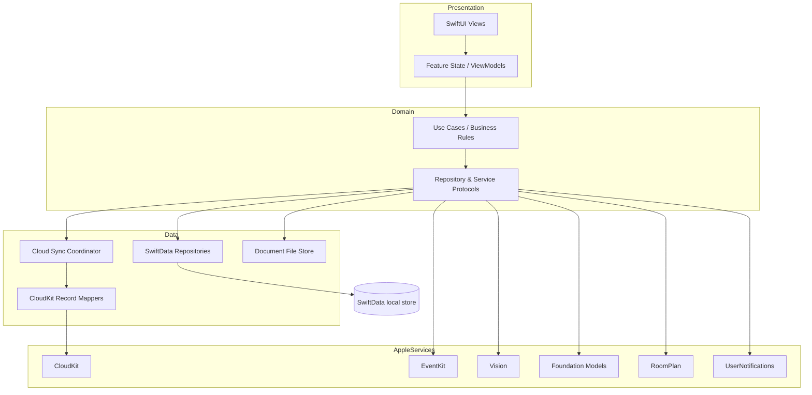
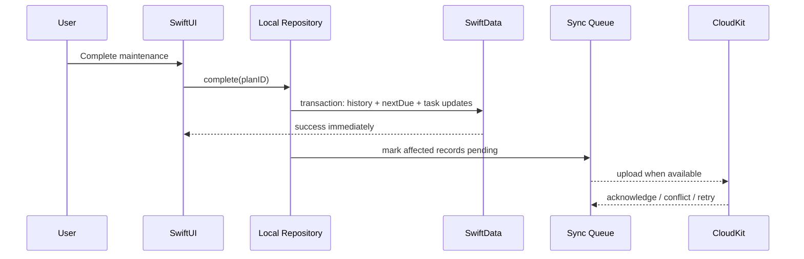
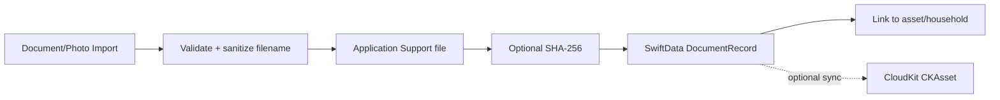
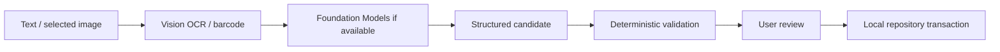

# Architecture

## 1. Goals

The architecture optimizes for:
- offline-first UX
- privacy
- evolvable household schema
- optional CloudKit collaboration
- deterministic business logic independent of AI
- Swift 6 concurrency correctness
- adaptive Apple-platform UI
- testability without live iCloud

## 2. High-level architecture



## 3. Local store is the UX source of truth

A write follows:



CloudKit failure does not roll back the local user action unless business semantics explicitly demand it.

## 4. Why not make CloudKit the primary repository?

- Screens would become network-sensitive.
- Shared-database availability would leak into basic UX.
- Offline use would become harder.
- Testing would require CloudKit fixtures.
- The privacy/product promise is “local first,” not “cloud app with cache.”

## 5. Why explicit CloudKit sharing

User-to-user collaboration requires `CKShare` semantics. Current Apple documentation describes CKShare over custom record zones/hierarchies. Apple DTS guidance in 2026 also cautions about mixing SwiftData automatic CloudKit mirroring with a separate `NSPersistentCloudKitContainer` sharing stack; direct CloudKit APIs are a reasonable approach for simple shared data.

Decision: SwiftData handles local persistence. A dedicated sync layer maps local records to explicit CloudKit records/zones/shares.

See ADR-001.

## 6. Feature module convention

Each feature may contain:

```text
Features/Home/
├── HomeView.swift
├── HomeViewModel.swift          # only if needed
├── RoomDetailView.swift
├── AssetDetailView.swift
└── Components/
```

Do not create a view model merely to rename simple `@Query` state. Introduce one when a feature coordinates multiple repositories/services, asynchronous work, or nontrivial state transitions.

## 7. Dependency injection

Do not use a mutable global service locator.

Preferred evolution:
- immutable `AppEnvironment`
- protocols for external services
- inject environment into feature coordinators/view models
- SwiftUI Environment may carry stable dependencies

Tests substitute local fakes/actors.

## 8. Concurrency model

- SwiftUI views and observable presentation models: `@MainActor` where mutable.
- Cloud sync: actor.
- document storage: actor.
- OCR/AI services: actors where they maintain sessions/state.
- repositories: actor or ModelActor-based design once implementation matures.

Avoid passing SwiftData model instances freely across actors. Prefer IDs/value snapshots across concurrency boundaries.

## 9. Persistence transaction boundaries

Atomic operations should include all locally dependent changes.

Example maintenance completion:
1. set maintenance `lastCompletedAt`
2. compute/set `nextDueAt`
3. create maintenance history record
4. complete linked generated task
5. generate next task if product rule says so

Only after local transaction succeeds are sync records queued.

## 10. Documents



Do not put PDF/image binary data in SwiftData attributes.

## 11. AI pipeline



A model never directly mutates persistence.

## 12. Calendar integration

LunaHearth family events remain independent records.

EventKit events are an external overlay/reference. The user may:
- display selected calendars
- optionally export/add a LunaHearth event to Apple Calendar
- later define visibility rules

Avoid two-way sync in the MVP. Two-way calendar synchronization creates duplicate/conflict semantics unrelated to core value.

## 13. Adaptive layout

Architecture should expose semantic selection state, not device-specific screens.

Example Home:
- compact: room list → navigation push → room detail
- expansive: `NavigationSplitView` with room list + detail
- future Duo posture adapter can influence column behavior without changing domain logic

## 14. Observability

Initial production logging uses Apple `Logger` only.

Rules:
- no private household strings in logs
- use categories: persistence, sync, import, calendar, ai
- diagnostics screen can expose status/counts and redacted error codes
- user explicitly exports diagnostics

## 15. Error taxonomy

Define domain-level errors rather than surfacing raw Apple framework errors directly.

Examples:
- `LocalStoreError`
- `CloudSyncError.accountUnavailable`
- `CloudSyncError.shareRevoked`
- `CalendarAccessError.denied`
- `ImportError.unsupportedType`
- `IntelligenceError.unavailable`

Map to concise recovery UI.
