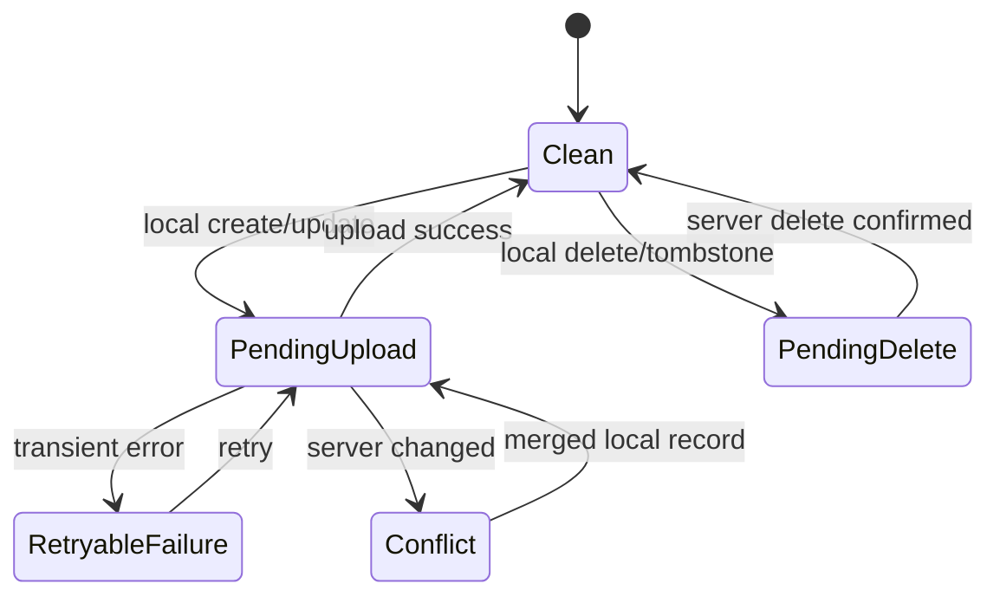

# CloudKit Sync & Family Sharing

## 1. Objective

Provide optional household collaboration through Apple iCloud without making CloudKit required for local use.

## 2. Architectural decision

Use:
- SwiftData as local persistence
- explicit CloudKit API for shared household synchronization
- one custom CloudKit record zone per household
- `CKShare` to share the household zone with participants

Do not assume SwiftData automatic CloudKit sync solves CKShare collaboration.

Apple references:
- https://developer.apple.com/documentation/cloudkit/ckshare
- https://developer.apple.com/documentation/cloudkit/sharing-cloudkit-data-with-other-icloud-users
- https://developer.apple.com/documentation/uikit/uicloudsharingcontroller

## 3. Databases

Owner:
- records originate in owner private database/custom zone
- zone shared using CKShare

Participant:
- records appear through shared database after accepting invitation

Local app always maintains a SwiftData projection for responsive/offline UI.

## 4. Zone strategy

One custom zone per household:

```text
Zone name: LHHousehold-<householdUUID>
```

Benefits:
- zone-level sharing can treat household as one collaboration unit
- zone change tracking is straightforward
- ownership boundary is explicit

Before implementation verify current SDK behavior/limits on the deployment SDK and test with two real iCloud accounts.

## 5. Record mapping

Record name = entity UUID string.

Every record fields include:
- id
- householdID
- createdAt
- modifiedAt
- entity-specific values
- schemaVersion where useful

Avoid field renames after production CloudKit schema deployment. Prefer additive changes.

## 6. Parent relationships

If using record-hierarchy sharing instead of zone sharing, CKShare hierarchy depends on CKRecord parent relationships, not arbitrary custom reference fields. Current plan prefers zone sharing for the entire household.

## 7. Local mutation state machine



## 8. Sync triggers

Safe triggers:
- app foreground
- explicit pull-to-refresh / Sync Now
- after local mutation with debounce
- background opportunities only when Apple permits and justified

Do not add unrestricted background modes.

## 9. Download algorithm

Per household zone:
1. load last server change token
2. request zone changes
3. map CKRecords to remote DTOs
4. merge into local store using conflict policy
5. persist new change token only after batch transaction succeeds
6. process deletions/tombstones

Change token expiration:
- reset token
- perform full zone re-fetch/reconciliation
- do not wipe local unsynced records

## 10. Upload algorithm

1. query local sync metadata for pending records
2. build CKRecords
3. save in bounded batches
4. use change tags/optimistic concurrency
5. process per-record partial failures
6. mark successful records clean
7. retry transient failures with backoff
8. surface permanent failures in diagnostics

## 11. Conflict policy

CloudKit server-record-changed is not solved by “server always wins” or “client always wins.”

Create merge functions per entity.

### Event
Latest field edit can often win, but recurrence/member assignment may need whole-entity resolution.

### Task
Merge independent fields where possible:
- title latest
- due latest
- completion monotonic unless user explicitly reopened later

Track modification metadata sufficiently to distinguish intentional reopen from stale write before implementing advanced merge.

### Grocery
Completion and name can merge independently.

### Asset
Prefer explicit conflict UI for simultaneous critical changes such as model/serial/purchase data if field-level history unavailable.

### Documents
Metadata can merge; file-version conflicts need separate asset strategy.

## 12. Sharing flow

Owner:
1. Enable iCloud Family Sync
2. create/ensure custom zone
3. upload local household
4. create CKShare for zone
5. present Apple collaboration UI/share sheet

Participant:
1. receives invitation/link
2. system opens LunaHearth share acceptance
3. accept share
4. create local shared-household shell
5. initial full fetch
6. mark household active after successful materialization

## 13. Permission model

CloudKit permissions: read-only/read-write participant capabilities.

Product roles: owner/adult/child/guest.

Do not confuse them. A child profile may not even be a CloudKit participant.

## 14. Owner leaves / participant removed

Must be deliberately designed and tested.

Participant removed:
- stop syncing
- do not silently pretend edits still reach family
- preserve a local recovery state or allow export according to product policy

Owner deletes share:
- warn clearly about impact
- require explicit destructive confirmation

Owner signs out of iCloud:
- local data remains available
- sync status becomes unavailable

## 15. Diagnostics

Expose:
- iCloud account status
- household role: local / owner / participant
- last successful sync timestamp
- pending upload count
- pending delete count
- retryable error count
- zone identifier (redacted/technical details in advanced view)

Do not expose share URLs or household content.

## 16. Testing matrix

Real-device/iCloud tests required for:
- owner invite participant
- participant accept
- offline edits both devices
- simultaneous edit
- participant removal
- share stopped
- iCloud sign-out/sign-in
- app reinstall
- large document sync/quota failure
- change token expiration simulation if possible

Normal unit tests should use CloudKit mapping/merge fakes and not require iCloud.

## Implemented first step: private manual backups

See [ADR-006](adr/006-private-cloudkit-backup.md). More → iCloud backup explicitly uploads a private snapshot; welcome → Restore from iCloud downloads, previews and restores into an empty local store. This transport is separate from the live collaboration design above. No automatic sync, CKShare, outbox or participant flow is enabled. Local-only hard deletions are compatible with complete snapshot replacement, but remain unsuitable for incremental collaboration.

## Implemented live transport — September 12, 2026

ADR-012 adds explicit private/shared zone sync, private CKShare invitations, scene-based acceptance, household switching, persistent per-record baselines/tombstones, incremental change tokens, optimistic writes, conflict review, and visible recovery/read-only states. Local updates trigger sync after a debounce; foreground polling runs every 20 seconds with failure backoff. Manual backup remains separate. No background push service is enabled. The existing design above describes the broader destination; physical two-account acceptance, tombstone compaction and large-file support remain release work.

## Private cloud deletion

ADR-013 adds separate owner-only synced-home deletion and manual-backup deletion controls in More. Both require destructive confirmation and preserve local household records. Household sync pauses durably before deletion and remains paused on failure; only an acknowledged deletion clears its local sync metadata. Participants cannot erase the owner’s cloud zone. Remote local copies and Apple Reminders are not erased.

## Private shopping stores (ADR-014)

Reusable ShoppingStore entities use the existing LHHouseholdEntity payload mapper
and owner-private/participant-shared zones. GroceryItem.storeID links are validated
against the household graph. No public store collection or new cloud field/type.
All participants must update because older builds reject the new entity kind.
Private backup snapshots also include stores independently of shopping items.

ADR-015 adds optional amount/unit/civil shopping-date values to the existing grocery
payload. No CloudKit type/key changes. Duplicate-item warnings use the locally
available household list; offline concurrent additions are not globally locked.

## Personal shopping change alerts (ADR-016)

Opt-in assignment notifications add private/shared CKDatabaseSubscription background hints for the active home. They reuse the existing sync engine and never publish shopping data to the public database. Delivery is best effort; foreground refresh remains necessary after missed pushes. Each device selects its household member explicitly. Physical two-account APNs validation remains pending; see ADR-016 for privacy and lifecycle limits.

## Inventory transport (ADR-017)

InventoryItem joins the existing LHHouseholdEntity record kinds, including backup restore and tombstones. Same-purchase IDs are deterministic across devices; changes still use three-way conflict handling. Shopping completion and inventory are atomic locally, while remote transport can temporarily deliver only part of a batch before retry. Old clients reject unsupported inventory kinds without wiping their local copy; update all household devices before using inventory with sharing. The production record type is unchanged; no public database is used.

## Inventory low-stock metadata (ADR-020)

The optional isLowStock flag is included in the existing InventoryItem entity payload and private/shared sync path. Legacy payloads omit it and decode as nil. Fake-server tests cover propagation; live two-account delivery remains unverified. No new CloudKit record type/key. Existing file-attachment and household-envelope limits remain documented in ADR-020.

ADR-022 adds separate opt-in task assignment alerts through the same existing private/shared database subscription. Task UUID baselines are device-local and independent from shopping. No record type or schema change. Physical cross-account notification validation remains required.

ADR-023 adds invitation-first root presentation, cold/warm delegate coverage,
visible empty-device errors, and an explicit onboarding entry for resolving a
pasted iCloud invitation or finding an already joined home. No schema change.
Pending invitations are not enumerated by opening the app normally.

ADR-024 adds owner-named invitations and automatic device-profile linking. Names
upload before a recipient is added to the private CKShare. No schema or public
storage change. Direct Apple sharing remains available for access management.

Native invitations and automatic account-linked profiles follow ADR 026. Profile creation uses the verified current device account after writable sync/import, not pre-invitation email discovery. The owner names profiles in Family; stable member IDs preserve assignments across devices and renames.

Build 27 adds PurchaseEntry to explicit household record mapping and sharing. Historical links may point to deleted records; snapshots survive. Both participants must use a build supporting PurchaseEntry. No automatic SwiftData mirroring is enabled. See ADR 030.

Build 33 adds optional meal recipe/servings/completion attributes and a preparation task meal reference to existing record payloads. Upgrade participating devices together so older editors do not erase unknown fields. Cooking writes a local transaction, then ordinary record synchronization; simultaneous offline stock edits still follow existing per-record conflict handling rather than a distributed stock ledger. See ADR 033.

### Weekly meals (build 38)
Build 38 adds optional per-serving recipe quantities to existing meal payloads. Existing private/shared sync carries accepted plans and shopping changes. Upgrade shared devices together; older clients may drop the new field on edit. See ADR 035.

### Appointment metadata (build 42)
FamilyEvent payloads carry optional appointmentKind and reminderMinutes through BackupCodec. Absent legacy values become nil; invalid incoming presentation kinds/offsets fall back to nil. Each repeated occurrence has its own locally generated UUID and standard conflict/tombstone behavior. Device notification authorization/recipient settings are not cloud records. New appointment alerts reconcile after sync; remote changes are only reflected after the receiving device fetches them. Older clients may omit the new metadata when editing, so upgrade sharing devices together.

### Optional Apple Calendar delivery (build 43)
CalendarDeliveryLink is strictly device-local and excluded from BackupCodec. Shared appointment edits can update an already opted-in link after this device receives them; receiving an event never opts it into Apple Calendar. Remote source deletion stops updates and exposes local review of any remaining Apple copy. One exporting device per destination Apple calendar is recommended; independent devices cannot coordinate EventKit writes while offline. Apple Calendar account sync runs separately from LunaHearth CloudKit sync.

Build 46 restock arithmetic uses existing inventory/grocery/purchase records and existing sync mapping, with no new zone/schema/permission. Sequential local purchases add known compatible quantities; simultaneous offline writes still use the existing per-record conflict model and are not a distributed additive stock ledger. Historical purchase replay markers remain in use. See ADR 039.

Build 47 includes optional PurchaseEntry.receiptLineKey in the existing payload, without new CloudKit record keys/types. Upgrade household devices together. Simulated two-repository tests verify offline receipt linking and replay protection; simultaneous quantity edits pause for explicit conflict review rather than automatic addition. These tests do not verify live CloudKit or APNs delivery.

### September 22 foreground energy audit
Foreground periodic reconciliation now waits 20 seconds after the initial refresh, rather than repeating immediately. Setup without a household does not run periodic or write-triggered reconciliation. Scene cancellation/home changes continue to stop the loop, and local writes still trigger a debounced refresh. No sync interval, ownership, conflict or transport semantics changed. See `docs/validation/2026-09-22-performance-energy.md` for measured results and physical-device limits.

### Public operational settings — ADR 049
A separate read-only public `LHAppConfiguration` / `ios-current` record provides app feature switches, notices and help text. This contains no household records and does not participate in private/shared sync, backups, conflict handling or ownership. Fixed fetches are bounded/cached; manual core workflows and existing data survive unavailable/expired configuration. See `PUBLIC_APP_CONFIGURATION.md` for permissions, publication and pending production validation.
