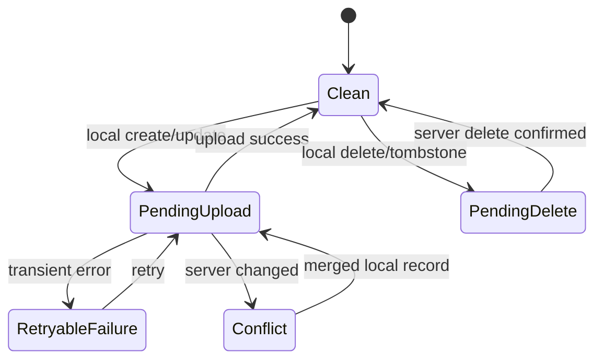

# CloudKit Sync & Family Sharing

## 1. Objective

Provide optional household collaboration through Apple iCloud without making CloudKit required for local use.

## 2. Architectural decision

Use:
- SwiftData as local persistence
- explicit CloudKit API for shared household synchronization
- one custom CloudKit record zone per household
- `CKShare` to share the household zone with participants

Do not assume SwiftData automatic CloudKit sync solves CKShare collaboration.

Apple references:
- https://developer.apple.com/documentation/cloudkit/ckshare
- https://developer.apple.com/documentation/cloudkit/sharing-cloudkit-data-with-other-icloud-users
- https://developer.apple.com/documentation/uikit/uicloudsharingcontroller

## 3. Databases

Owner:
- records originate in owner private database/custom zone
- zone shared using CKShare

Participant:
- records appear through shared database after accepting invitation

Local app always maintains a SwiftData projection for responsive/offline UI.

## 4. Zone strategy

One custom zone per household:

```text
Zone name: LHHousehold-<householdUUID>
```

Benefits:
- zone-level sharing can treat household as one collaboration unit
- zone change tracking is straightforward
- ownership boundary is explicit

Before implementation verify current SDK behavior/limits on the deployment SDK and test with two real iCloud accounts.

## 5. Record mapping

Record name = entity UUID string.

Every record fields include:
- id
- householdID
- createdAt
- modifiedAt
- entity-specific values
- schemaVersion where useful

Avoid field renames after production CloudKit schema deployment. Prefer additive changes.

## 6. Parent relationships

If using record-hierarchy sharing instead of zone sharing, CKShare hierarchy depends on CKRecord parent relationships, not arbitrary custom reference fields. Current plan prefers zone sharing for the entire household.

## 7. Local mutation state machine



## 8. Sync triggers

Safe triggers:
- app foreground
- explicit pull-to-refresh / Sync Now
- after local mutation with debounce
- background opportunities only when Apple permits and justified

Do not add unrestricted background modes.

## 9. Download algorithm

Per household zone:
1. load last server change token
2. request zone changes
3. map CKRecords to remote DTOs
4. merge into local store using conflict policy
5. persist new change token only after batch transaction succeeds
6. process deletions/tombstones

Change token expiration:
- reset token
- perform full zone re-fetch/reconciliation
- do not wipe local unsynced records

## 10. Upload algorithm

1. query local sync metadata for pending records
2. build CKRecords
3. save in bounded batches
4. use change tags/optimistic concurrency
5. process per-record partial failures
6. mark successful records clean
7. retry transient failures with backoff
8. surface permanent failures in diagnostics

## 11. Conflict policy

CloudKit server-record-changed is not solved by “server always wins” or “client always wins.”

Create merge functions per entity.

### Event
Latest field edit can often win, but recurrence/member assignment may need whole-entity resolution.

### Task
Merge independent fields where possible:
- title latest
- due latest
- completion monotonic unless user explicitly reopened later

Track modification metadata sufficiently to distinguish intentional reopen from stale write before implementing advanced merge.

### Grocery
Completion and name can merge independently.

### Asset
Prefer explicit conflict UI for simultaneous critical changes such as model/serial/purchase data if field-level history unavailable.

### Documents
Metadata can merge; file-version conflicts need separate asset strategy.

## 12. Sharing flow

Owner:
1. Enable iCloud Family Sync
2. create/ensure custom zone
3. upload local household
4. create CKShare for zone
5. present Apple collaboration UI/share sheet

Participant:
1. receives invitation/link
2. system opens LunaHearth share acceptance
3. accept share
4. create local shared-household shell
5. initial full fetch
6. mark household active after successful materialization

## 13. Permission model

CloudKit permissions: read-only/read-write participant capabilities.

Product roles: owner/adult/child/guest.

Do not confuse them. A child profile may not even be a CloudKit participant.

## 14. Owner leaves / participant removed

Must be deliberately designed and tested.

Participant removed:
- stop syncing
- do not silently pretend edits still reach family
- preserve a local recovery state or allow export according to product policy

Owner deletes share:
- warn clearly about impact
- require explicit destructive confirmation

Owner signs out of iCloud:
- local data remains available
- sync status becomes unavailable

## 15. Diagnostics

Expose:
- iCloud account status
- household role: local / owner / participant
- last successful sync timestamp
- pending upload count
- pending delete count
- retryable error count
- zone identifier (redacted/technical details in advanced view)

Do not expose share URLs or household content.

## 16. Testing matrix

Real-device/iCloud tests required for:
- owner invite participant
- participant accept
- offline edits both devices
- simultaneous edit
- participant removal
- share stopped
- iCloud sign-out/sign-in
- app reinstall
- large document sync/quota failure
- change token expiration simulation if possible

Normal unit tests should use CloudKit mapping/merge fakes and not require iCloud.

## Implemented first step: private manual backups

See [ADR-006](adr/006-private-cloudkit-backup.md). More → iCloud backup explicitly uploads a private snapshot; welcome → Restore from iCloud downloads, previews and restores into an empty local store. This transport is separate from the live collaboration design above. No automatic sync, CKShare, outbox or participant flow is enabled. Local-only hard deletions are compatible with complete snapshot replacement, but remain unsuitable for incremental collaboration.
