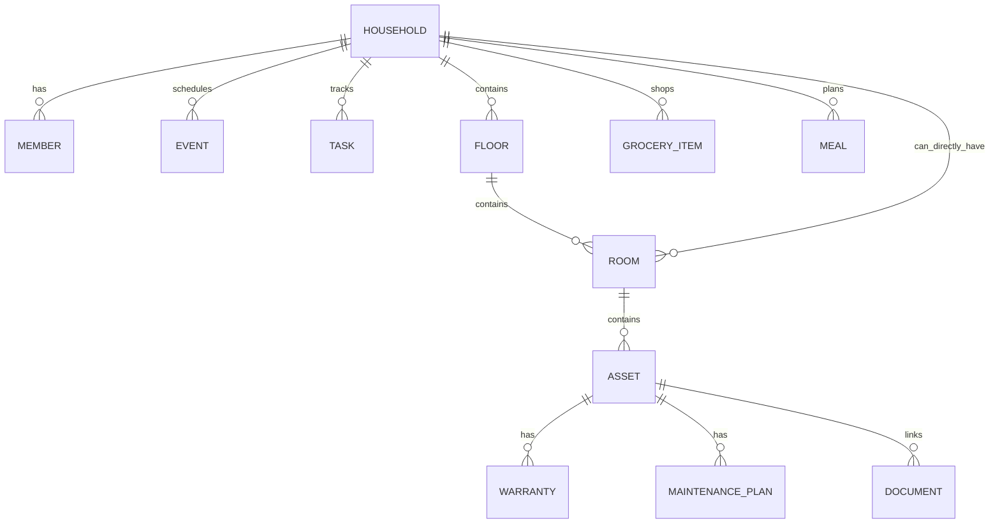

# Data Model

> Current foundation (ADR-012): local household reminders, shopping, schedules and home records support optional private CloudKit sync and CKShare invitations. Foreground changes sync automatically; live two-account device acceptance is still a release check. Apple Reminders is a separate optional connection. Setup no longer asks for a room. Earlier Apple-only/manual-backup-only implementation notes below are historical. See [ADR-012](ADR/012-live-private-household-sharing.md).


## 1. Modeling philosophy

The household is a graph of small independently syncable records. Do not store the whole app state as one encoded blob.

Core relationship:



## 2. Common fields

Every syncable entity should eventually contain or be associated with:
- `id: UUID`
- `householdID: UUID`
- `createdAt: Date`
- `modifiedAt: Date`
- archive/deletion state when history matters

CloudKit metadata belongs in a separate sync metadata model where practical.

## 3. Household

Fields:
- id
- name
- createdAt
- modifiedAt
- localMode/sharedMode state (add later)
- cloud zone identifier metadata (sync layer)

Do not store Apple Account identifiers as product identity.

## 4. HouseholdMember

Fields:
- id
- householdID
- displayName
- role: owner/adult/child/guest
- color token
- avatar metadata later

Avoid sensitive profile fields unless product need is clear.

MVP child is a profile/assignment target, not an account.

## 5. FamilyEvent

Fields:
- id
- householdID
- title
- startAt/endAt
- allDay flag (add)
- assignedMemberID optional
- notes optional
- source: LunaHearth / external reference
- location text optional later
- recurrence model later

External EventKit events should normally be represented as value snapshots at runtime, not persisted as full duplicated events.

## 6. HouseholdTask

Fields:
- id
- householdID
- title
- dueAt optional
- assignedMemberID optional
- completion state
- recurrence
- relatedAssetID optional
- generatedSource metadata later

Before production replace raw recurrence string with a structured model such as:

```text
RecurrenceRule
- frequency: daily/weekly/monthly/yearly
- interval: Int
- weekdays: Set<Weekday>?
- dayOfMonth: Int?
- endDate: Date?
```

## 7. GroceryItem

Fields:
- id
- householdID
- name
- quantity text
- category
- completion state
- relatedAssetID optional
- generatedByMaintenancePlanID optional later

Separate “checked off” from deletion so collaborative lists can resolve state cleanly.

## 8. MealPlanEntry

Fields:
- id
- householdID
- date-only semantic date
- meal type
- title
- notes

Important: current scaffold uses `Date`; production implementation should define a date-only strategy so a meal does not move days across time zones.

## 9. HomeFloor

Fields:
- id
- householdID
- name
- sortIndex

Examples: First Floor, Second Floor, Basement, Exterior.

## 10. Room

Fields:
- id
- householdID
- floorID optional
- name
- sortIndex
- RoomPlan local asset reference optional

A room may be unassigned to floor.

## 11. HomeAsset

Fields:
- id
- householdID
- roomID optional
- name
- category
- manufacturer
- modelNumber
- serialNumber
- purchaseDate
- purchasePriceMinorUnits
- currencyCode
- notes
- archive state later

Categories are product taxonomy, not manufacturer truth. Keep an `other` category.

## 12. Warranty

Fields:
- id
- householdID
- assetID
- provider
- startDate/endDate
- policy/reference number
- notes

Derived status computed at runtime.

One asset may have multiple warranties (manufacturer + store protection plan), so do not enforce one-to-one.

## 13. MaintenancePlan

Fields:
- id
- householdID
- assetID
- title
- recurrence/cadence
- lastCompletedAt
- nextDueAt
- replacement/shopping template

Add `MaintenanceHistory` before production:
- id
- planID
- completedAt
- performedByMemberID optional
- cost minor units optional
- notes
- document IDs optional

## 14. DocumentRecord

Fields:
- id
- householdID
- optional assetID
- title
- kind
- relative local path
- UTType/MIME metadata (add)
- file size (add)
- optional SHA-256
- created/modified

Kinds:
- receipt
- warranty
- manual
- insurance
- registration
- school
- other

Documents may later link to events/tasks, so consider a generic association table if cross-linking grows.

## 15. Settings

Household-level settings might include:
- warranty alert horizons
- maintenance due-soon horizon
- week start day
- default currency
- default units

Device-local settings:
- selected external calendars
- notification authorization/status cache
- last selected tab/view preferences

Do not sync device-specific authorization state.

## 16. Sync metadata

Suggested local entity:

```text
SyncMetadata
- entityType: String
- entityID: UUID
- cloudRecordName: String
- lastKnownChangeTag: String?
- localRevision: Int64
- state: clean/pendingUpload/pendingDelete/conflicted/failed
- lastAttemptAt: Date?
- errorCode: String?
```

For efficient fetch, persist CloudKit server change tokens separately by zone.

## 17. Deletion

For collaborative data, immediate hard deletion can cause conflicts.

Recommended:
- lightweight list rows may use tombstones until server confirms
- assets/documents with history should archive by default
- “Delete household” is a separate destructive workflow with export warning

## 18. CloudKit record naming

Use deterministic record names:

```swift
CKRecord.ID(recordName: entity.id.uuidString, zoneID: householdZoneID)
```

Do not use auto-generated record names because it makes reconciliation harder.

## 19. Schema evolution checklist

Before changing a model:
1. Is existing user data preserved?
2. Is CloudKit field change additive?
3. Does export format need version change?
4. Does sync mapper support old records?
5. Do tests cover migration/default values?
6. Does new field contain sensitive information that changes privacy disclosures?

## Local implementation update — September 2026

`MealPlanEntry` now adds optional `dateKey` (`YYYY-MM-DD`, Gregorian civil date). The legacy `date` instant is retained for additive migration compatibility. New writes store the civil key; nil legacy keys are backfilled from the device-local day at first upgrade. Queries and edits preserve the stored civil day across time-zone changes.

`MaintenanceHistory` is implemented with `id`, `householdID`, `planID`, `completedAt`, `createdAt`, and `modifiedAt`. It is saved atomically with maintenance completion and next-due rescheduling. Cost, performer, notes, and attachments remain future additions.

Local-only planning records currently use confirmed hard deletion. Assets and histories do not expose deletion. Tombstones and sync metadata are still required before optional CloudKit transport can be enabled. See `IMPLEMENTATION_REVIEW.md` for migration and release limitations.

## Manual room geometry — September 2026

`Room` adds optional `layoutX`, `layoutZ`, `layoutWidth`, `layoutDepth`, `layoutHeight` (Double meters), and `layoutPreset` (String). Coordinates are local to the selected floor, not geographic positions. Nil geometry preserves legacy rooms as unplaced; nothing is inferred from room names. The change is additive, with no record deletion or file conversion. SwiftData can infer the optional-field migration; a production upgrade fixture and minimum-OS device verification remain release checks.

Layout saves update the existing Room UUID atomically, preserving floor and asset links. Rectangular footprints must have valid finite dimensions and cannot overlap another placed room on the same floor. Unassigned rooms share a separate planning plane. The local-only transport remains disabled; sync mapping/tombstones must be added before collaboration is enabled.

## Private backup values — September 2026

CloudKit backup support adds versioned per-entity Codable values without changing the SwiftData schema. UUIDs, relationships, currency minor units, civil meal dates, room geometry and maintenance history survive restore into a fresh store. Document metadata and local file paths are excluded; backup refuses households containing document/scan files. Complete snapshot replacement accounts for local deletions; this does not implement the tombstones required for incremental family sync. See ADR-006 for integrity limits and privacy review.

## Device-local Reminders outbox — September 2026

ADR-008 adds `ReminderDeliverySettings` (household UUID, enabled flag, default destination list ID) and `ReminderDeliveryLink` (task UUID, household UUID, original destination, optional external identifier, sent/attempted task revisions, last attempt and controlled error). New task + link save atomically. These additive tables do not change existing task records, never enter household CloudKit backups, and start absent/disabled on upgrade or restore. Linked-task deletion removes local metadata without propagating an external deletion. A disk-based migration test verifies preservation of legacy household/task data; another verifies pending delivery survives reopening.

### Apple-owned shopping items (ADR-010)

New shopping items no longer create GroceryItem records. Apple Reminders stores their title, quantity note and completion. Legacy GroceryItem records and backup decoding remain intact for non-destructive recovery. Shopping/reminder destination IDs are independent device preferences. No SwiftData schema change is required.

## Shopping store and buyer — September 12, 2026

GroceryItem adds optional storeName (user-entered store label, not a location) and assignedMemberID (stable UUID referencing a member of the same household). Existing items migrate with nil values and appear under Any store / Anyone can buy. Store labels are trimmed and limited to 200 characters. Quantity and completion stay on the same stable item record. Editing preserves maintenance asset links.

Backup/sync Codable fields are additive and optional, so old snapshots without either field restore successfully. New records validate buyer references against the household graph. No CloudKit record type/key changes are needed because the values are in the existing per-entity payload. All collaborating devices should use the updated build to avoid older clients dropping new fields during edits. Physical upgrade fixtures remain a release check. These fields participate in the existing user-enabled private sharing scope; no location tracking or external store service is added.

## Shopping timing — Now / Later

GroceryItem adds optional neededLater. Nil/false means Now (include in the next shop); true means Later (future shopping). This is an explicit user priority, not a due-date instant or automatic reminder. No date/time-zone conversion is involved. The optional field preserves existing records and older Codable snapshots, which default to Now. Editing, backup restore and private household sync preserve the choice. AI review applies the user-selected timing to the confirmed batch; the model does not set it.

### Shopping store names

The offline shopping catalog suggests chain names and reuses saved custom shops.
`GroceryItem.storeName` remains optional text: no store entity or schema migration
is introduced. Manual saves, edits, and reviewed AI batches canonicalize known
aliases and equivalent spellings. Presentation also groups legacy variants without
rewriting records. Different branch names remain distinct. The existing backup
and private household sync payload includes store name, buyer and Now/Later.

## Reusable private stores (ADR-014)

ShoppingStore now owns id, householdID, name, optional branch, createdAt and
modifiedAt. GroceryItem.storeID is optional and storeName remains a fallback.
Store creation and item linking are atomic; deleting items never deletes stores.
Writable homes backfill old labels idempotently, preserving the labels. Existing
stores and references are included in backup/explicit private household sync.
See ADR-014 for migration, ID, conflict and older-client compatibility details.

## Shopping amounts and planned dates (ADR-015)

GroceryItem now has optional quantityAmount, quantityUnit and plannedDay. Amounts
use normalized decimal strings; units are stable enum values. quantityText stays
as a backward-compatible display/custom-description field. plannedDay is a Gregorian
civil-date key, selected for Later and cleared for Now. Optional Codable fields
preserve old snapshots; old text quantities remain editable with Other units.

## Home grocery inventory (ADR-017)

InventoryItem is a normalized household pack/batch with stable UUID and timestamps. Name is required; quantityText, packDetails, location, storeName/storeID and packed/expiry/purchased civil-day keys are optional. sourceGroceryID is non-owning provenance. isUsedUp retains exhausted packs. GroceryItem.purchaseDisposition is optional for backward payload decoding. Purchases use a household-and-grocery-derived inventory UUID and one local transaction; manual packs use fresh UUIDs. Backups and explicit CloudKit mapping include inventory; deletes use tombstones. Schema changes are additive, without automatically converting previously completed groceries.

## Inventory attention (ADR-020)

InventoryItem.isLowStock is an optional Bool, default nil for old records/payloads. It records the user's per-pack Running low flag. Backup/sync mapping includes the value. Existing name/quantity/date data is unchanged; no automatic consumption, quantity totals or stock thresholds are inferred. Old collaborating clients should update to avoid dropping this optional field during edits.

ADR-024 adds admin-named invitation profiles without new fields. Linked member UUIDs
are derived from the home UUID and opaque container-scoped participant identity;
raw Apple account identifiers and invitation emails are not member fields. The
UUID is a display/assignment link, never authentication or authorization.

### Receipt import marker (ADR-028)

GroceryItem.receiptImportKey is an optional SHA-256 line marker, nil for pre-receipt records. It is included in normalized backup/shared sync mapping. It prevents the same recognized receipt line from being imported twice while purchase history is retained. No receipt photos or raw OCR text are persisted. Existing stores migrate additively; household devices should upgrade together to preserve the marker on edits.

### HouseholdExpense (ADR-029)

A normalized purchase/refund record with UUID, householdID, merchant, civil day, positive amountMinorUnits (integer), currencyCode, categoryRawValue, isRefund, optional notes/receiptKey, createdAt and modifiedAt. Six supported two-decimal currencies are reported separately; no converted combined balance. Expense deletion uses sync tombstones and never cascades to grocery or inventory records. Added model migration is non-destructive; older household app versions must be upgraded before syncing this entity kind.

### PurchaseEntry (build 27)
A normalized purchased line grouped by purchaseID, with optional expenseID, groceryID and inventoryID; immutable name/quantity/merchant/day snapshots, optional confirmed item amountMinorUnits/currencyCode, stockAction (added/restocked/elsewhere), householdID and timestamps. IDs are locally deterministic per source purchase. Historical references allow absent deleted targets but reject wrong kinds. No old purchase history is inferred. See ADR 030.

### Cooking workflow (ADR 033)
MealPlanEntry optionally carries ingredientNames, preparationSteps, servings and cookedAt. HouseholdTask optionally references mealID; deleting a meal may leave its historical task independently usable. Backup mapping validates a present meal reference's kind and tolerates a deleted target. InventoryItem quantityText remains backward compatible; measured decimal/unit values use canonical text, while unmeasured descriptions remain valid and are never used for arithmetic. No new record kind or destructive conversion.

### Weekly meals (build 38)
MealPlanEntry now has optional ingredientAmountsPerServing, mapping recipe ingredient names to measured decimal/unit strings for one serving. Old records decode without it. See ADR 035.

### Appointment metadata (build 42)
FamilyEvent adds optional `appointmentKind: String?` and `reminderMinutes: Int?`. Nil preserves existing generic events with no reminders. Kind values are user-selected calendar presentation categories; reminder offsets are 0, 15, 60, or 1440 minutes. Explicit BackupCodec mapping includes both fields. Bounded repeat creation stores independent FamilyEvent records, with no opaque recurrence blob or automatic series edits. Existing user data is preserved by additive optional fields; upgrade all sharing devices before editing the new metadata.

### Device-local Apple Calendar outbox (build 43)
Added CalendarDeliveryLink to the local SwiftData schema. Its event/household IDs, selected calendar name/ID, external ID, marker recovery dates, source revision, attempt/error state, configuration token, and explicit removal flag never enter household backups or CloudKit payloads. The new table is additive; existing events stay unlinked until the user opts in. Appointment and initial outbox creation are one transaction. Shared FamilyEvent schema is unchanged.

Build 46 changes restock business rules only: compatible quantityText measures and matching package counts add on a new reviewed purchase. Replay markers still prevent repeated addition. No schema change or retroactive balance rewrite. See ADR 039.

Build 47 adds optional PurchaseEntry.receiptLineKey for durable receipt reconciliation. It is nullable for old stores/payloads, validated as a 64-character hex digest, and included in backups. Existing purchase identity and stock snapshots are retained when receipt grouping/expense evidence is attached. See ADR 040.

### Public operational configuration (ADR 049)
A new public CloudKit record type `LHAppConfiguration` uses a fixed `ios-current` record ID and one bounded versioned `payload` String. It describes publisher-controlled feature availability and plain text only; it is not a household entity. No householdID, member identifier, migration, backup format change, private/shared schema field or SwiftData table is introduced. Device-local UserDefaults caches the validated value and refresh timestamps. Production schema deployment and permission validation remain required separately.
