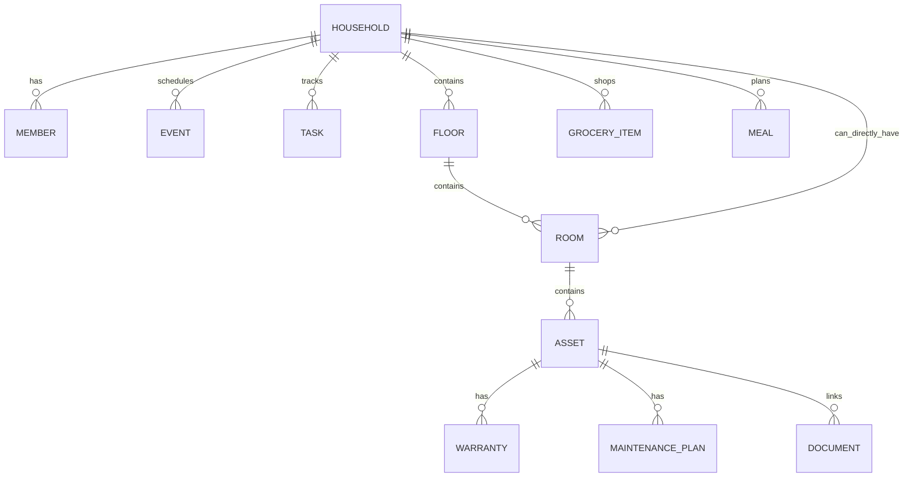

# Data Model

## 1. Modeling philosophy

The household is a graph of small independently syncable records. Do not store the whole app state as one encoded blob.

Core relationship:



## 2. Common fields

Every syncable entity should eventually contain or be associated with:
- `id: UUID`
- `householdID: UUID`
- `createdAt: Date`
- `modifiedAt: Date`
- archive/deletion state when history matters

CloudKit metadata belongs in a separate sync metadata model where practical.

## 3. Household

Fields:
- id
- name
- createdAt
- modifiedAt
- localMode/sharedMode state (add later)
- cloud zone identifier metadata (sync layer)

Do not store Apple Account identifiers as product identity.

## 4. HouseholdMember

Fields:
- id
- householdID
- displayName
- role: owner/adult/child/guest
- color token
- avatar metadata later

Avoid sensitive profile fields unless product need is clear.

MVP child is a profile/assignment target, not an account.

## 5. FamilyEvent

Fields:
- id
- householdID
- title
- startAt/endAt
- allDay flag (add)
- assignedMemberID optional
- notes optional
- source: LunaHearth / external reference
- location text optional later
- recurrence model later

External EventKit events should normally be represented as value snapshots at runtime, not persisted as full duplicated events.

## 6. HouseholdTask

Fields:
- id
- householdID
- title
- dueAt optional
- assignedMemberID optional
- completion state
- recurrence
- relatedAssetID optional
- generatedSource metadata later

Before production replace raw recurrence string with a structured model such as:

```text
RecurrenceRule
- frequency: daily/weekly/monthly/yearly
- interval: Int
- weekdays: Set<Weekday>?
- dayOfMonth: Int?
- endDate: Date?
```

## 7. GroceryItem

Fields:
- id
- householdID
- name
- quantity text
- category
- completion state
- relatedAssetID optional
- generatedByMaintenancePlanID optional later

Separate “checked off” from deletion so collaborative lists can resolve state cleanly.

## 8. MealPlanEntry

Fields:
- id
- householdID
- date-only semantic date
- meal type
- title
- notes

Important: current scaffold uses `Date`; production implementation should define a date-only strategy so a meal does not move days across time zones.

## 9. HomeFloor

Fields:
- id
- householdID
- name
- sortIndex

Examples: First Floor, Second Floor, Basement, Exterior.

## 10. Room

Fields:
- id
- householdID
- floorID optional
- name
- sortIndex
- RoomPlan local asset reference optional

A room may be unassigned to floor.

## 11. HomeAsset

Fields:
- id
- householdID
- roomID optional
- name
- category
- manufacturer
- modelNumber
- serialNumber
- purchaseDate
- purchasePriceMinorUnits
- currencyCode
- notes
- archive state later

Categories are product taxonomy, not manufacturer truth. Keep an `other` category.

## 12. Warranty

Fields:
- id
- householdID
- assetID
- provider
- startDate/endDate
- policy/reference number
- notes

Derived status computed at runtime.

One asset may have multiple warranties (manufacturer + store protection plan), so do not enforce one-to-one.

## 13. MaintenancePlan

Fields:
- id
- householdID
- assetID
- title
- recurrence/cadence
- lastCompletedAt
- nextDueAt
- replacement/shopping template

Add `MaintenanceHistory` before production:
- id
- planID
- completedAt
- performedByMemberID optional
- cost minor units optional
- notes
- document IDs optional

## 14. DocumentRecord

Fields:
- id
- householdID
- optional assetID
- title
- kind
- relative local path
- UTType/MIME metadata (add)
- file size (add)
- optional SHA-256
- created/modified

Kinds:
- receipt
- warranty
- manual
- insurance
- registration
- school
- other

Documents may later link to events/tasks, so consider a generic association table if cross-linking grows.

## 15. Settings

Household-level settings might include:
- warranty alert horizons
- maintenance due-soon horizon
- week start day
- default currency
- default units

Device-local settings:
- selected external calendars
- notification authorization/status cache
- last selected tab/view preferences

Do not sync device-specific authorization state.

## 16. Sync metadata

Suggested local entity:

```text
SyncMetadata
- entityType: String
- entityID: UUID
- cloudRecordName: String
- lastKnownChangeTag: String?
- localRevision: Int64
- state: clean/pendingUpload/pendingDelete/conflicted/failed
- lastAttemptAt: Date?
- errorCode: String?
```

For efficient fetch, persist CloudKit server change tokens separately by zone.

## 17. Deletion

For collaborative data, immediate hard deletion can cause conflicts.

Recommended:
- lightweight list rows may use tombstones until server confirms
- assets/documents with history should archive by default
- “Delete household” is a separate destructive workflow with export warning

## 18. CloudKit record naming

Use deterministic record names:

```swift
CKRecord.ID(recordName: entity.id.uuidString, zoneID: householdZoneID)
```

Do not use auto-generated record names because it makes reconciliation harder.

## 19. Schema evolution checklist

Before changing a model:
1. Is existing user data preserved?
2. Is CloudKit field change additive?
3. Does export format need version change?
4. Does sync mapper support old records?
5. Do tests cover migration/default values?
6. Does new field contain sensitive information that changes privacy disclosures?

## Local implementation update — September 2026

`MealPlanEntry` now adds optional `dateKey` (`YYYY-MM-DD`, Gregorian civil date). The legacy `date` instant is retained for additive migration compatibility. New writes store the civil key; nil legacy keys are backfilled from the device-local day at first upgrade. Queries and edits preserve the stored civil day across time-zone changes.

`MaintenanceHistory` is implemented with `id`, `householdID`, `planID`, `completedAt`, `createdAt`, and `modifiedAt`. It is saved atomically with maintenance completion and next-due rescheduling. Cost, performer, notes, and attachments remain future additions.

Local-only planning records currently use confirmed hard deletion. Assets and histories do not expose deletion. Tombstones and sync metadata are still required before optional CloudKit transport can be enabled. See `IMPLEMENTATION_REVIEW.md` for migration and release limitations.

## Manual room geometry — September 2026

`Room` adds optional `layoutX`, `layoutZ`, `layoutWidth`, `layoutDepth`, `layoutHeight` (Double meters), and `layoutPreset` (String). Coordinates are local to the selected floor, not geographic positions. Nil geometry preserves legacy rooms as unplaced; nothing is inferred from room names. The change is additive, with no record deletion or file conversion. SwiftData can infer the optional-field migration; a production upgrade fixture and minimum-OS device verification remain release checks.

Layout saves update the existing Room UUID atomically, preserving floor and asset links. Rectangular footprints must have valid finite dimensions and cannot overlap another placed room on the same floor. Unassigned rooms share a separate planning plane. The local-only transport remains disabled; sync mapping/tombstones must be added before collaboration is enabled.

## Private backup values — September 2026

CloudKit backup support adds versioned per-entity Codable values without changing the SwiftData schema. UUIDs, relationships, currency minor units, civil meal dates, room geometry and maintenance history survive restore into a fresh store. Document metadata and local file paths are excluded; backup refuses households containing document/scan files. Complete snapshot replacement accounts for local deletions; this does not implement the tombstones required for incremental family sync. See ADR-006 for integrity limits and privacy review.
