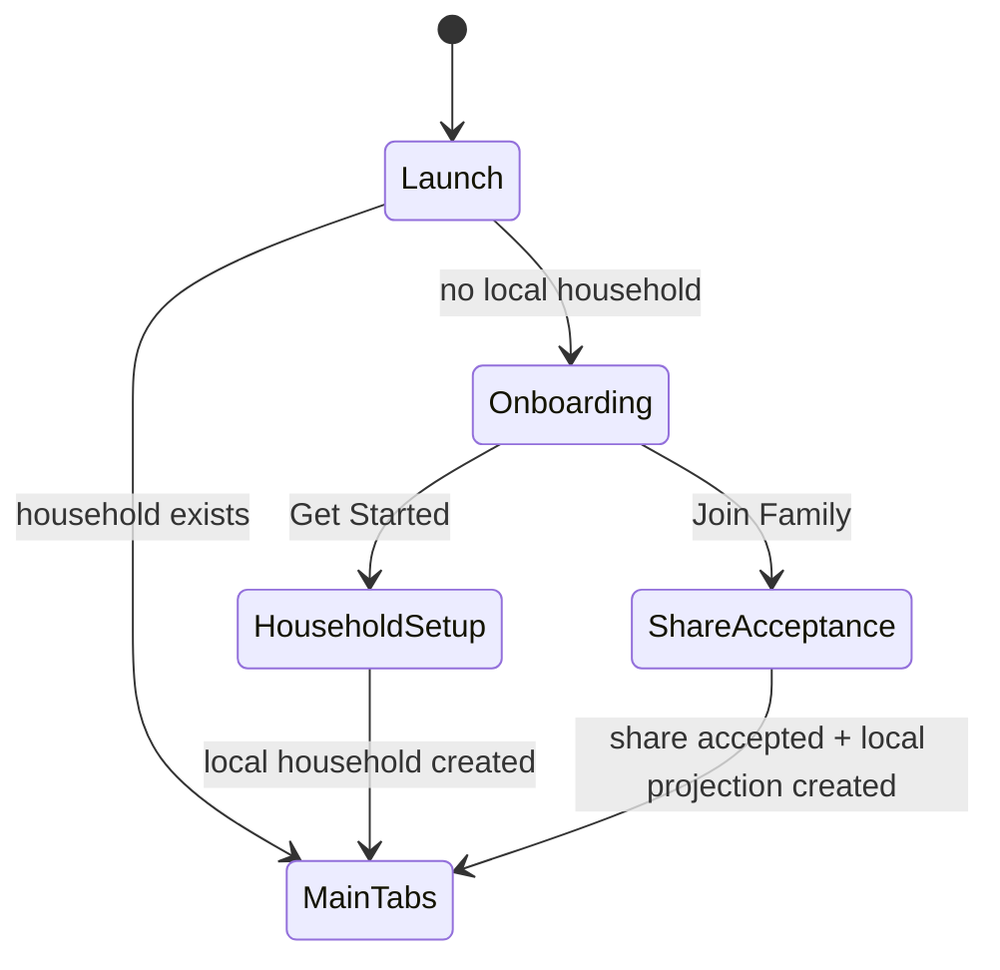
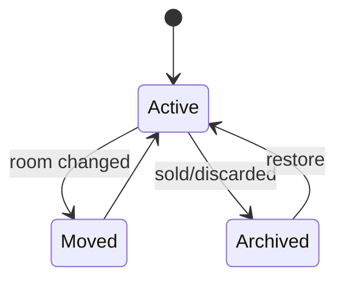

# Low-Level Design (LLD)

## 1. Scope

This document defines implementation-level boundaries, state transitions, service contracts, data flows, and screen behavior for the initial LunaHearth codebase.

## 2. Root application flow



The current scaffold uses an onboarding completion flag; Phase 1 must replace this as the source of truth with actual local household existence.

## 3. Main tabs

### 3.1 Today

Inputs:
- current local day/time zone
- FamilyEvent repository
- HouseholdTask repository
- Warranty repository
- Maintenance repository
- Meal repository
- Grocery repository

Suggested presentation state:

```swift
struct TodaySnapshot: Sendable {
    let events: [TodayEvent]
    let urgentTasks: [TodayTask]
    let maintenanceAlerts: [MaintenanceAlert]
    let warrantyAlerts: [WarrantyAlert]
    let meal: MealSummary?
    let openShoppingCount: Int
}
```

A `TodayUseCase` should query repositories and produce a capped/ranked snapshot. The view should not contain the ranking algorithm.

### 3.2 Calendar

Owned records:
- `FamilyEvent`

External overlay:
- `ExternalCalendarEventSnapshot` from EventKit adapter

Never persist a raw `EKEvent` object.

Recommended merge algorithm:
1. fetch LunaHearth events intersecting visible interval
2. fetch selected EventKit calendar snapshots if permission available
3. normalize to display model
4. sort by start, all-day semantics, source priority
5. deduplicate only using explicit external identifiers, never title/date heuristics

### 3.3 Home

Selection state:

```swift
struct HomeSelection: Equatable {
    var floorID: UUID?
    var roomID: UUID?
    var assetID: UUID?
}
```

Compact flow:
`Home → Floor/Room → Room → Asset → Warranty/Maintenance/Documents`

Expansive flow:
left column = floors/rooms
right column = selected room or asset

Do not require 3D scene navigation to access any item.

### 3.4 Lists

Sub-features:
- Tasks & chores
- Groceries
- Meals
- Routines

Each has its own repository/use cases but shares one root tab.

### 3.5 More

- Documents
- Family
- Sync & privacy
- Settings
- Diagnostics
- Export/delete

## 4. Quick Add

### Entry points
- Today toolbar `+`
- Calendar `+`
- Home `+`
- Lists `+`

### Quick Add state

```text
QuickAddSheet
├── free text input
├── suggested parse (optional)
└── explicit type buttons
    ├ Event
    ├ Task
    ├ Grocery
    ├ Meal
    ├ Home Item
    └ Maintenance
```

Flow:
1. user enters free text or chooses explicit form
2. local parser runs immediately
3. Foundation Models parser may enhance when available
4. produce `QuickAddDraft`
5. validation marks uncertainty
6. user confirms
7. repository transaction saves locally
8. optional sync queue gets dirty records

### Draft value type

Do not pass persistence models through AI parsing.

```swift
struct QuickAddDraft: Sendable {
    enum Kind: Sendable { case event, task, grocery, meal, asset, maintenance }
    var kind: Kind
    var title: String
    var startAt: Date?
    var dueAt: Date?
    var memberID: UUID?
    var roomID: UUID?
    var recurrence: RecurrenceDraft?
    var confidence: Double?
    var warnings: [String]
}
```

## 5. Household setup

Data created in one local transaction:
- Household
- Owner member
- optional members
- default settings

Do not require iCloud.

Recommended setup screens:
1. Welcome
2. Home name
3. Add people (optional)
4. “Start local” confirmation
5. Today

After users understand the app, Settings/Family may offer `Enable iCloud Family Sync`.

## 6. Member model and authorization

MVP local authorization is product-level, not security authentication.

### Owner
- manage household share
- manage members
- delete/export household

### Adult
- edit normal family/home data

### Child
- assignment/profile target only; no authenticated session

### Guest
- deferred

When CloudKit sharing ships, server-side CloudKit permission provides data-sharing enforcement while product roles provide UX/business rules.

## 7. Home asset lifecycle



Prefer archive over hard delete for assets with service/document history. Hard deletion is an explicit destructive action.

## 8. Warranty lifecycle

Fields:
- provider
- startDate
- endDate
- reference/policy number
- notes
- document IDs

Derived states:
- unknown
- active
- expiringSoon(days)
- expired

Do not persist “status” when it can be deterministically derived from dates and current time.

## 9. Maintenance lifecycle

Model should evolve to include:
- cadence type (days/months/custom)
- interval
- due strategy (from last completion vs fixed calendar)
- grace window
- linked replacement shopping template

Initial deterministic algorithm for day-based interval:

```text
complete at T
lastCompletedAt = T
nextDueAt = calendar.addDays(T, intervalDays)
```

Use Calendar APIs to avoid seconds-based assumptions across DST.

Create a `MaintenanceHistory` entity before production to preserve every completion/service record rather than overwriting only `lastCompletedAt`.

## 10. Grocery connection

A maintenance plan may have `shoppingItemTemplate` such as `20x25x1 HVAC filter`.

Product rule options:
- propose addition when maintenance enters due-soon window
- never auto-add repeatedly
- store generated-source metadata so completion/removal does not duplicate

MVP should require user confirmation for generated shopping additions.

## 11. Documents

### Local file layout

```text
Application Support/
└── LunaHearthDocuments/
    └── <householdUUID>/
        └── <documentUUID>/
            └── original.<ext>
```

Metadata includes:
- UUID
- householdID
- optional assetID
- kind
- original filename (sanitized/display only)
- relative stored path
- MIME/UTType identifier (add before production)
- file size
- optional SHA-256
- created/modified

Do not trust user-provided extension alone; use Uniform Type Identifiers where possible.

## 12. OCR/extraction

### Receipt
Candidates:
- merchant
- purchase date
- total
- currency
- product/model text

### Appliance label
Candidates:
- manufacturer
- model
- serial

### Event flyer
Candidates:
- event title
- date
- start/end
- location text
- notes/action item

All candidates go through a confirmation view.

## 13. Cloud sync low-level design

Each syncable local entity maps to one CloudKit record with recordName equal to UUID string.

Suggested record types:
- `LHHousehold`
- `LHMember`
- `LHEvent`
- `LHTask`
- `LHGroceryItem`
- `LHMeal`
- `LHFloor`
- `LHRoom`
- `LHAsset`
- `LHWarranty`
- `LHMaintenancePlan`
- `LHDocument`

Household owns one custom record zone. Zone sharing via CKShare means all household records can be shared as a unit. This simplifies participant consistency.

### Local sync metadata
Do not pollute every domain model with CloudKit-specific types. Maintain metadata table/entity:

```text
SyncMetadata
- entityType
- entityID
- lastKnownServerChangeTag
- localRevision
- syncState
- lastErrorCode
- lastAttemptAt
```

Potential states:
- clean
- pendingUpload
- pendingDelete
- conflicted
- failedRetryable
- failedPermanent

### Conflict handling

Default policy: field/entity-level deterministic latest-modified resolution only where safe. Special entities need tailored rules.

Examples:
- task completion: completed should not be accidentally reverted by stale title edit; merge fields where possible
- grocery item: preserve completion + latest name edits when independent
- home asset: avoid overwriting documents/maintenance relationship changes

CloudKit’s record change tag should be used for optimistic concurrency. On server-record-changed, fetch/merge/retry rather than blindly save-overwrite.

## 14. Share acceptance

`Join Family` does not mean login.

Flow:
1. system provides CloudKit share metadata to app
2. accept share
3. discover shared household zone
4. fetch records
5. materialize local SwiftData projection
6. mark household as shared participant
7. enter Today

Need explicit partial/failure states; never show empty Today as if successful if materialization failed.

## 15. On-device AI service

Protocol:

```swift
protocol HouseholdIntelligenceService: Sendable {
    func parse(text: String) async throws -> ParsedHouseholdInput
}
```

Evolve to typed methods rather than one giant prompt:
- `parseQuickAdd`
- `extractEvent`
- `extractAssetLabel`
- `extractReceipt`
- `summarizeToday`

A rule-based implementation stays available for tests/fallback.

## 16. Notifications

Use local `UNUserNotificationCenter` notifications initially.

Notification identifiers should use stable domain IDs, e.g.:
`maintenance.<uuid>.due`

Reschedule when due date changes. Cancel when record deleted/disabled.

Do not schedule hundreds of distant notifications blindly; maintain a rolling horizon if system limits make it appropriate.

## 17. Error UX

### Local store error
Blocking error + export/recovery when possible.

### iCloud unavailable
Nonblocking: remain local-only.

### Calendar denied
Show connect CTA/settings guidance; do not break family calendar.

### Foundation Models unavailable
Use manual/rule-based form without nagging.

### RoomPlan unsupported
Hide/disable Scan Room with clear reason; manual Add Room remains.

## 18. Accessibility

- Dynamic Type including accessibility sizes
- VoiceOver labels for icons
- member color must be accompanied by name/icon/text
- 44pt minimum practical touch targets
- 3D room model has list equivalent
- no gesture-only required action
- support Reduce Motion

## 19. Localization

Design dates, numbers, currency, units, and names for localization from day one.

- `Date.FormatStyle`
- `Measurement` / `MeasurementFormatter` when dimensions arrive
- ISO currency codes
- avoid concatenated English sentence fragments

## 20. Migration strategy

Before public data exists, model edits may be iterative. Once TestFlight users hold meaningful data:
- every destructive schema change requires migration plan
- export/import format versioned
- CloudKit schema changes staged in development container then deployed
- record fields should generally be additive; avoid renaming CloudKit fields after production without migration
