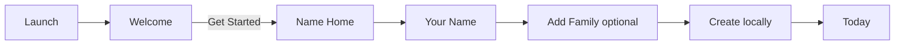
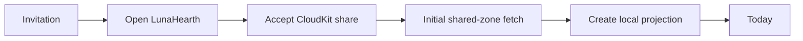
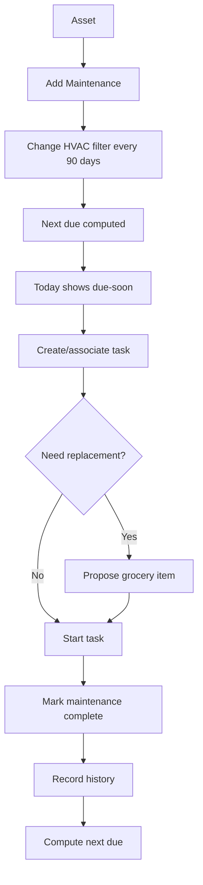

# User Flows

## 1. New local household



No permission or iCloud requirement.

## 2. Join an existing household



If initial materialization fails, show a recoverable sync state; do not create a misleading empty household.

## 3. Add family event

```text
Today/Calendar → + → Event → title/date/time/member → Save locally
                                   ↓ optional
                         Add to Apple Calendar
```

Apple Calendar permission is not required to create LunaHearth events.

## 4. Add appliance manually

```text
Home → Room → Add Item
→ category/name
→ manufacturer/model/serial optional
→ purchase/warranty optional
→ maintenance optional
→ Save
```

Fast path requires only name.

## 5. Add appliance by label

```text
Room → Add Item → Scan Label
→ camera permission if needed
→ Vision OCR/barcode
→ optional Foundation Model structuring
→ review model/serial/manufacturer
→ Save local asset
```

## 6. Receipt to asset

```text
Asset → Add Receipt
→ system picker/camera
→ local file vault
→ OCR
→ proposed merchant/date/amount
→ user confirms
→ update purchase fields + link document
```

## 7. Maintenance workflow



## 8. Warranty expiration

```text
Asset warranty → expires within horizon
→ Today alert
→ user opens asset
→ view receipt/warranty docs
→ optional task “inspect before warranty ends”
```

No automatic service booking in MVP.

## 9. Grocery flow

```text
Lists → Groceries
→ quick add
→ check items in store
→ completed items remain temporarily/history policy
```

Maintenance may *propose* replacement items.

## 10. Enable family sync

```text
More → Privacy & Sync
→ Enable iCloud Family Sync
→ explain what changes
→ check iCloud account
→ create household zone
→ upload local records
→ create share
→ show Invite Family Member
```

Important: sync enablement must not destroy local data if any CloudKit step fails.

## 11. Calendar connection

```text
Calendar → Connect Apple Calendar
→ explanatory screen
→ request access
→ choose calendars
→ show external events as overlay
```

Permission denied:
LunaHearth family calendar continues normally.

## 12. Room scan

```text
Home → Add/Scan Room
→ if RoomPlan supported: explain scan → camera permission → scan → review → save
→ if unsupported: Add Room manually
```

## 13. Delete household

Before public release:

Local-only owner:
`More → Export optional → Delete Household → confirmation → delete metadata + local files`

Shared owner/participant requires separate semantics and clear warnings. Do not implement a generic delete button that can accidentally destroy a CKShare for everyone.

## Manual home layout

Home → Build your home → choose a floor (or unassigned rooms) → Add a room → choose a preset → set name, dimensions and position → Save. Presets supply editable starting dimensions, never measured dimensions. New rooms are automatically placed in an open spot. Existing rooms can be given geometry from the room list or room detail without losing belongings. Cancel discards the draft.

The floor workspace switches between a 2D plan and a rotatable orthographic 3D cutaway. A labeled room list provides an accessible alternative; position steppers avoid drag-only editing. Exact measurements can be typed or adjusted with meter or foot increments and are stored in meters. A floor plan is a rectangular planning aid; door/window placement, arbitrary wall shapes, furniture placement, scanning, and architectural export are not implemented in this iteration.

Everything is local. No camera, location, network, account, or new permission is required.

## Dragging rooms

Home → Build your home → 2D Plan (or Arrange rooms from 3D). Drag a colored room tile; its footprint previews during the gesture. Positions snap to a quarter-meter grid and nearby room edges. A valid drop saves to the local store. An overlapping drop is rejected, with an explanation, and the room returns to its saved position. Tap selects a room; the sliders button opens its exact dimension/position editor. Zoom and Fit rooms keep larger floors reachable. VoiceOver exposes named move actions, and the numeric editor remains available.

`visual-review/interactive-layout.html` is a separate interactive browser demo using sample rooms. It supports pointer dragging, keyboard movement, dimensions, zoom, Undo, and a 3D preview, but does not write to the native app or persist after reload. The other HTML galleries contain static screenshots.

## 360-degree camera controls

In the Home workspace and room editor, drag the 3D preview horizontally to orbit through 360 degrees, and vertically to tilt between 15 and 75 degrees. Camera movement does not change room measurements or positions. Home retains an angle slider and Reset action; VoiceOver can adjust rotation and use named tilt actions. Arrange rooms switches to the 2D placement workspace.

The interactive browser demo also supports dragging anywhere in 3D to orbit and tilt, plus orbit/tilt sliders, rotation buttons, arrow keys and Reset view. Reload an already open demo page to receive the updated controls. Browser demo camera and room data remain ephemeral sample state.

## Home: room → item → care

The main Home page now begins with **Add a room** and **Add an item**, followed by the room list, all items with their room names, and layout/care tools. Floors group rooms and have an explicit Add room action. Adding a room with only one floor preselects that floor. Adding an item with only one room preselects that room; otherwise the user chooses a room or keeps it unassigned.

Open a room → **Add an item to [room]** → enter its name and optional category/manufacturer/model → Save. The item form confirms the room and does not offer unrelated entry types. The room lists its items with a details/warranty/maintenance cue. Open an item → Add Warranty or Add Maintenance → save. Completing maintenance records service history and schedules the next occurrence when repeating. Replacement items are added to groceries only on an explicit tap.

Room name/floor editing and 2D/3D layout creation remain accessible from Room settings. Home → Arrange rooms in 2D / 3D remains available independently of the item workflow. No schema, ownership, or privacy behavior changed.
